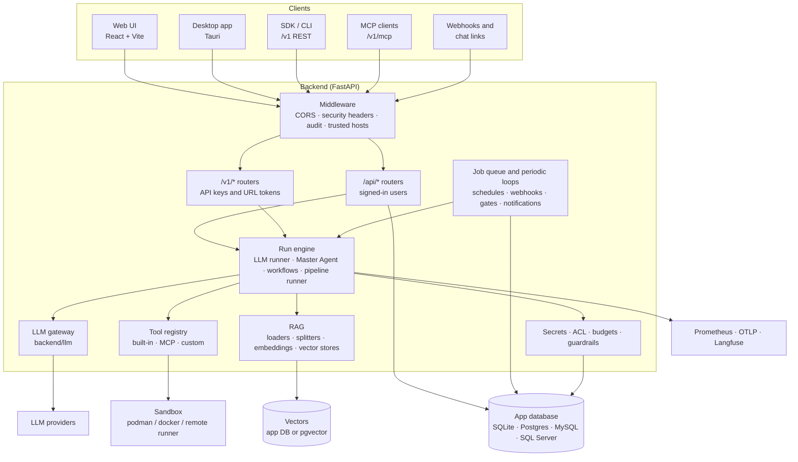

# Architecture

Pipesets AI is a FastAPI backend and a React frontend that share one app database. The backend
does all the real work: it runs pipelines, calls models through its own LLM gateway, runs tools in
a sandbox, and owns secrets, access control and the audit log. The frontend is the builder UI,
plus a separate public chat page. A Tauri desktop app wraps the same UI and starts its own backend.

These pages explain how the pieces fit together, for people changing the code. For using the
product, see the [user guide](../guide/README.md). For running it in production, see
[DEPLOYMENT.md](../../DEPLOYMENT.md).

## System overview



## Pages

| Page | What it covers |
|---|---|
| [Backend](backend.md) | App startup, middleware, how routers are grouped and authenticated, the services layer |
| [Run engine](runtime.md) | What happens when a pipeline runs: LLM runs, Master Agents, workflows, pipelines calling pipelines |
| [LLM gateway](llm-gateway.md) | One entry point for every model call: backends, key resolution, pricing |
| [Tools, MCP and RAG](tools-and-rag.md) | The tool and loader registries, MCP servers, the sandbox, vector stores |
| [Security model](security.md) | Tenancy, sign-in, ACLs, API keys, secrets, guardrails, audit log |
| [Background work](background-jobs.md) | The durable job queue, schedules, webhooks, Human Gate timeouts, notifications |
| [Data and storage](data-and-storage.md) | The app database, migrations, the data folder, vector storage, shared state |
| [Observability](observability.md) | Traces, Prometheus metrics, OpenTelemetry, Langfuse |
| [Frontend](frontend.md) | The React app, its state hooks, the canvas, the public chat page |
| [Deployment topologies](deployment.md) | Local, Compose, Kubernetes, the edge proxy and the desktop app |

## Design principles

These choices show up across the codebase. Keep to them when adding features.

1. **Only published versions run outside the editor.** Publishing freezes an immutable,
   numbered snapshot. Schedules, webhooks, `/v1`, MCP, chat links and Call Pipeline nodes all
   run the latest published snapshot, so editing a draft never breaks what is live.
2. **One path per concern.** Every model call goes through `llm/`. Every tool call goes through
   `tools.execute()`. Every background run is a job. A feature can't skip key checks, pricing,
   tracing or retries by calling something lower down.
3. **Credentials never live in flows.** Nodes hold `secret://` references or sealed `enc://`
   values. The server resolves them just before a call. Saving a flow with a plaintext key is
   refused.
4. **Everything is scoped to a tenant and project.** Every query filters by both, taken from
   the request context, never from the request body.
5. **Registries over switch statements.** Tools, MCP servers and document loaders are found by
   scanning their packages. Adding one is adding one file.
6. **Safe with many replicas.** Jobs, schedules, gate sweeps and cancel signals are coordinated
   through the database (or Redis), so any number of backend or worker processes can run.
7. **`/v1` changes are additive only.** Breaking changes go to `/v2`.

## Repository map

```
backend/
├── main.py              app setup: middleware, routers, background loops
├── db.py · paths.py     database access; data folder
├── models.py            Pydantic request / response models
├── routers/             HTTP endpoints, one module per area (/api, /v1)
├── services/            business logic: runners, jobs, secrets, auth, audit, …
├── llm/                 LLM gateway: types, backends, catalog, pricing
├── tools/               built-in tools and MCP servers (auto-registered)
├── loaders/             document loaders (auto-registered)
├── agents/              built-in agent packages
├── exporters/           LangChain, CrewAI, AutoGen, notebook, Docker exports
├── migrations/          Alembic schema migrations
├── sandbox_runner.py    remote sandbox service
├── desktop_main.py      backend entry point for the desktop app
└── tests/               pytest suites by area
frontend/src/
├── App.tsx              top-level views and the canvas
├── components/          views and panels (Build, Monitor, Eval, Lab, Settings, …)
├── nodes/               one React Flow component per canvas node type
├── hooks/ · context/    app, flow, catalog, auth, tenant and credentials state
├── chat/                the public chat-link page (separate entry point)
└── utils/               API helpers, validation, formatting
desktop/                 Tauri shell (src-tauri/src/main.rs)
sdk/                     Python SDK, CLI and stdio MCP server
deploy/                  Compose, Kubernetes, edge proxy, Grafana dashboard
```
