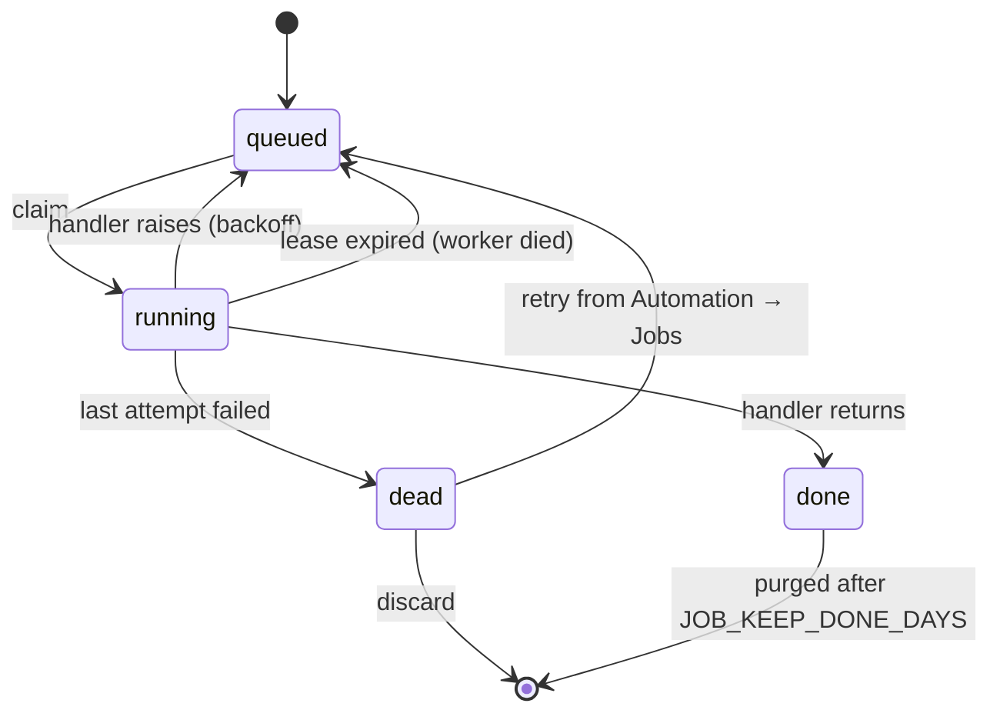

# Background work

Anything nobody waits for in a request, such as scheduled runs, webhook runs, notifications and
Human Gate timeouts, runs as a **job** or a **periodic loop**. Both are coordinated through the
app database, so they work the same way with one process or many replicas.

## Job queue

The queue is [services/jobs.py](../../backend/services/jobs.py). A job is a row in `jobs` with a
kind, a JSON payload and a status. Workers claim jobs from that table. A worker runs either
inside the API process (the default) or on its own with `python manage.py worker` and
`PIPESETS_WORKER=external` on the API pods.

- **Exactly one winner.** A claim is a conditional `UPDATE` on `(id, status, attempts)`, so only
  one worker gets a job on any database. `attempts` doubles as a fencing token: a worker that has
  lost its job can't complete or fail it afterwards.
- **Leases.** A running job holds `locked_until`, and its worker renews it every third of
  `LEASE_SECONDS`. If a worker crashes or is killed, its job goes back to the queue once the
  lease expires.
- **At-least-once.** A handler can run twice for the same job, for example after a crash between
  finishing the work and marking it done. Write handlers to be idempotent.
- **Dead letters.** Jobs that use up every attempt stay dead until someone retries or discards
  them in **Automation → Jobs**. A handler's `on_dead` hook lets the source record the failure.
- **Cancel** works from any replica, using [shared state](data-and-storage.md#shared-state).

## Periodic loops

`@jobs.periodic` loops take turns across processes, so each tick runs in one process only:

| Loop | Module | Does |
|---|---|---|
| Scheduler | `services/scheduler.py` | Fires due cron schedules as `schedule.run` jobs |
| Gate sweep | `services/gates.py` | Applies Human Gate timeouts and marks dead runs `interrupted` |
| Audit retention | `services/audit.py` | Purges audit entries older than `AUDIT_RETENTION_DAYS` |
| Job purge | `services/jobs.py` | Removes old done and dead jobs |

## Schedules

Each due schedule is also claimed with a conditional `UPDATE` on `next_run_at`, so overlapping
ticks fire it only once. If the server was down, a missed firing runs once on the next tick, not
once for every missed slot. A firing is skipped while the previous one is still queued or running.

A scheduled run uses the pipeline's latest published snapshot and acts as the schedule's owner.
Failed runs are retried with backoff. Runs refused by a guardrail or budget, rejected at a Human
Gate, or that can't start are not retried, because a retry won't fix them. After `max_failures`
failed firings in a row, the schedule pauses itself and sends an alert.

## Webhooks

`POST /v1/hooks/{token}` checks the token, and the HMAC signature if one is configured. It then
builds the prompt from the webhook's template (`{{body.a.b}}`, `{{query.x}}`) and queues a run job.
Runs behave like scheduled runs.

## Human Gate timeouts

A paused gate with `timeout_hours` gets an `expires_at`. Each time the sweep runs, it applies the
gate's `on_timeout` setting:

- `reject` ends the run.
- `approve` resumes it as an `agent.resume` job.
- `escalate` sends one escalation alert and keeps the run waiting.

Each gate is acted on once, guarded by `timed_out_at`.

## Notifications

`services/notifier.py` sends alerts to the project's channels (Slack or a JSON webhook) when a run
fails, a Human Gate pauses or times out, or a schedule pauses itself. Channel URLs are stored
sealed.
