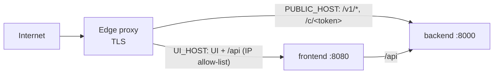
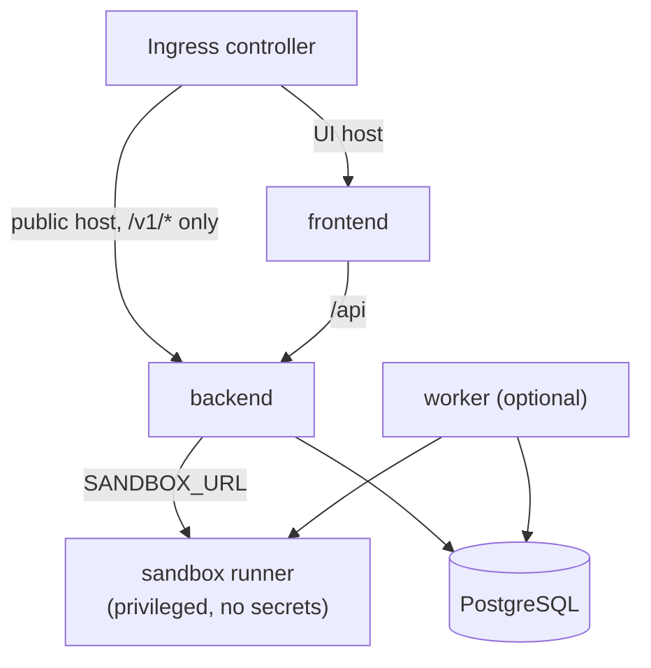

# Deployment topologies

The same two images, `pipesets-ai-backend` (FastAPI on `:8000`) and `pipesets-ai-frontend` (nginx
on `:8080`, which serves the UI and proxies `/api`), run in every server setup. Step-by-step
instructions are in [DEPLOYMENT.md](../../DEPLOYMENT.md). This page describes how the pieces are
arranged in each setup.

## Local development

`./start.sh` creates `backend/.venv`, installs dependencies (again only when `requirements.txt`
changes), and starts uvicorn on `:8000` and Vite on `:5173` in the background. It uses SQLite, an
in-process job worker and `memory` shared state. `./stop.sh` stops both.

## Docker or Podman Compose

`deploy/compose/compose.yaml` runs the backend and frontend containers with a `/data` volume.
`compose.edge.yaml` adds the edge proxy.

## Edge proxy

`deploy/edge/` is an nginx image that terminates TLS (Let's Encrypt via certbot) and splits
traffic across two hostnames:

- `PUBLIC_HOST` serves only the public API: `/v1`, webhooks, chat links and the chat page.
- `UI_HOST` serves the builder and its `/api`, and can be limited to office or VPN ranges in
  `ui-allow.conf`.

## Kubernetes

`deploy/k8s/` is a Kustomize setup:

| Manifest | Role |
|---|---|
| `backend.yaml`, `frontend.yaml` | The two services |
| `worker.yaml` | Optional job workers. Needs PostgreSQL, `PIPESETS_WORKER=external` on the backend, and `PIPESETS_SHARED_STATE=database` or `redis`. |
| `sandbox.yaml` | The sandbox runner with its own rootless podman. It's the only privileged pod, holds only `SANDBOX_TOKEN`, and mounts no backend data. |
| `networkpolicy.yaml` | Allows only ingress → frontend, ingress → backend (`/v1`), frontend → backend, and backend → sandbox. Nothing else in the cluster can reach `/api`. |
| `ingress.yaml`, `config.yaml`, `secret.example.yaml` | Routing, settings and secrets |

By default, SQLite sits on a ReadWriteOnce volume, which allows one backend pod. To scale out,
switch to PostgreSQL and shared state in the database or Redis.

## Desktop app

`desktop/` is a Tauri shell ([src-tauri/src/main.rs](../../desktop/src-tauri/src/main.rs)):

1. It finds a free `127.0.0.1` port and starts the backend there, either from `backend/.venv` or
   as the PyInstaller build. The backend entry point is `backend/desktop_main.py`.
2. It gives the backend its own data folder (on macOS,
   `~/Library/Application Support/ai.pipesets.desktop/`), and limits `ALLOWED_HOSTS` to loopback.
3. It shows `loading.html` until `/health` responds, then loads the same React UI.
4. Quitting stops the backend, and a watchdog also stops it if the app crashes.

On first launch, the app copies the web setup's database, master key and uploads, so existing
pipelines carry over. After that, the two setups are separate. The desktop app has no installer
yet, and only macOS has been tested ([desktop/README.md](../../desktop/README.md)).
