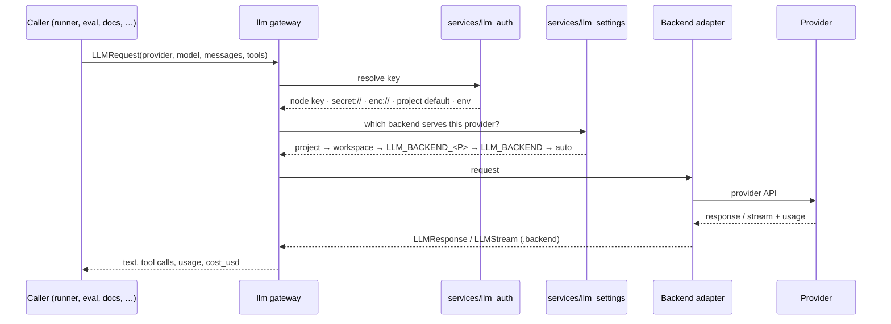

# LLM gateway

Every model call in the backend goes through [backend/llm/](../../backend/llm/). Nothing outside
`llm/backends/` imports a provider SDK. The gateway replaced LiteLLM as the main path. LiteLLM is
still available as one optional backend among several.

```python
import llm

resp = await llm.complete(llm.LLMRequest(provider="openai", model="gpt-4o", messages=[...]))
stream = await llm.stream(req)
async for chunk in stream:
    ...
```

## Layout

| File | Purpose |
|---|---|
| `llm/__init__.py` | `complete()`, `stream()`, `metered()`, and backend selection |
| `llm/base.py` | `LLMRequest`, `LLMResponse`, `LLMStream`, `Chunk`, and the backend contract |
| `llm/backends/` | Adapters: `openai_compat`, `anthropic`, `gemini`, `bedrock`, `mistral`, `cohere`, `ollama`, `watsonx`, `litellm` |
| `llm/catalog.py` | Providers, models and default models shown in the UI |
| `llm/pricing.py`, `llm/prices/` | The gateway's own price table |

Messages and tool schemas use the OpenAI chat format everywhere. A backend for a provider with a
different format converts at its own edge.

## Request path



1. **Key resolution** (`services/llm_auth.py`) happens in the gateway, so no backend can skip the
   vault's kind checks. In order: the node's own key (plaintext, a `secret://` reference or a
   sealed value), then the project's default secret for the provider, then the server
   environment. Only secrets of kind `llm` can reach a model call.
2. **Backend choice** comes from **Settings → Model backends**, most specific first: project,
   workspace, `LLM_BACKEND_<PROVIDER>`, `LLM_BACKEND`, then `auto`. `auto` picks the first
   backend in `llm.backends.auto_order` that supports the provider, with the built-in adapters
   ahead of LiteLLM. A node's own base URL overrides the settings.
3. **Cost** is calculated from the gateway's price table and the usage the backend reports:
   `resp.cost_usd`, or `stream.cost_usd` once a stream has been read to the end.

## Metering

`with llm.metered() as meter:` adds up the cost of every call made inside the block, including
calls in tasks it starts. Evals use this to price a whole pipeline run, nested pipelines
included (`meter.usd`).

## What stays with callers

Retries, fallback models and overall timeouts are handled by the callers, mainly
`llm_runner.py`, not by the gateway.

## Adding a provider

1. If the provider speaks the OpenAI API, add it to the catalog and let `openai_compat` serve it.
2. Otherwise add an adapter in `llm/backends/` that implements the contract in `llm/base.py`, and
   add it to `auto_order`.
3. Add prices to `llm/prices/`.
4. Add a contract cassette under `backend/tests/gateway/llm_contract/`. Tests never call a real
   provider.
