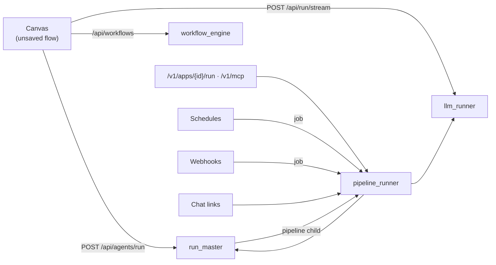
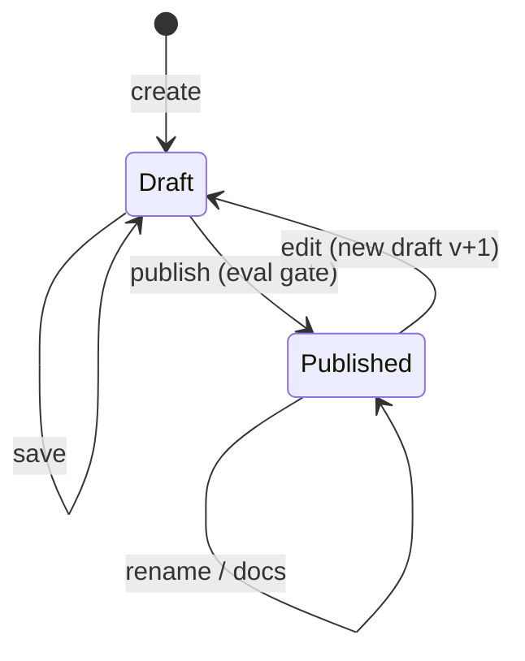

# Run engine

A pipeline is a saved canvas flow: React Flow nodes and edges stored as JSON in `apps.flow_data`.
Running one means turning that graph into calls to models, tools and retrievers. There are four
kinds of run, and each has its own executor.

| Kind | When | Executor |
|---|---|---|
| Single LLM | The flow's core is one LLM node, with its tools, skills, memory, cache, retriever and guardrails | `services/llm_runner.py` |
| Master Agent | The flow has a Master Agent node with Child Agents | `routers/agents.py` (`run_master`) |
| Workflow | The flow is made of Workflow Step nodes | `services/workflow_engine.py` |
| Pipeline | A published app run by id, from anywhere outside the editor | `services/pipeline_runner.py` |

## Where runs come from

- **From the canvas**, the browser sends the current, possibly unsaved, flow. For a single-LLM
  run, the frontend works out what is wired to the LLM node (tools, memory, retriever and so on)
  and sends it as one request to `POST /api/run/stream`.
- **From everywhere else**, only a published snapshot runs. `pipeline_runner.py` loads it and
  does the same wiring resolution on the server, then hands it to the LLM runner or the
  Master Agent executor. Schedules, webhooks, `/v1`, MCP and chat links all use this path, and
  run as a specific user (the key's creator, the schedule's owner, the link's creator), so ACLs,
  budgets and guardrails always apply.

## A single-LLM run

`llm_runner.run_stream()` returns server-sent events (`token`, `thought`, `tool_call`, `tool`,
`step`, `meta`, `done`, `error`). In order, a run:

1. Checks the budget (`services/budget.py`) and the prompt guardrails (moderation, PII, prompt
   injection, custom rules).
2. Looks in the response cache, if a Cache node is attached.
3. Loads conversation memory, and long-term memory if it's enabled, trimmed to the token budget.
4. Fetches RAG context from the attached retriever and reranker.
5. Calls the model through the [LLM gateway](llm-gateway.md), streaming tokens. On provider
   errors, it tries the node's fallback models.
6. Runs a ReAct-style tool loop for up to `MAX_AGENT_STEPS` (8) steps. Each tool call goes
   through the [tool registry](tools-and-rag.md), with secrets resolved on the server.
7. Checks the response guardrails. These apply mid-stream too, so a response can be retracted
   while it streams.
8. Applies output parsers, saves memory and cache, and writes the trace with per-step cost.

## Master Agent runs

A Master Agent plans with its own LLM, sends tasks to Child Agents, and synthesizes their outputs.
A child can be an LLM with tools, an external agent (an HTTP endpoint), or a published pipeline,
which is how pipelines nest. Three strategies:

- **sequential**: children run one at a time, and each one sees the previous child's output.
- **parallel**: all children run at once, and the master combines the results.
- **dynamic**: the master picks the next child from what it has so far, up to `max_steps`.

Master Agent runs are durable. Each finished step is recorded in `agent_runs`
(`services/checkpoint.py`), so a run can pause at a **Human Gate** and resume when a reviewer
decides, and a run interrupted by a crash can continue. Provider keys are never stored with
the run; a resume sends them again. Runs send heartbeats, and the gate sweep marks runs that
stop heartbeating as `interrupted`, so a restarting replica never touches another replica's
live runs.

## Workflows

A workflow is a conversational flow of `wf_step` nodes. Unlike a pipeline run, it can pause to wait
for the user:

- `ask`, `choice` and `confirm` steps send a prompt, save the state and return `waiting_input`.
- `tool_call` and `message` steps run straight through.

The state is plain JSON (`variables`, `current_node`, `history`) that `routers/workflows.py`
saves between requests. Each run is pinned to the flow version it started with. One `advance`
call runs at most `MAX_STEPS` nodes, so loops can't spin forever.

## Pipelines calling pipelines

A **Call Pipeline** node is a Child Agent of kind `pipeline` that points at another published app.
`pipeline_runner.py` runs it with the caller's tenant, project and access. It rejects cycles
(A → B → A) and nesting deeper than `MAX_DEPTH`. The cost of every model call, nested
pipelines included, is added to the parent run, which is how evals price a whole pipeline.

## Draft, publish, edit

Publishing (`POST /api/apps/{id}/publish`) can be gated by an eval dataset
(`services/publish_gate.py`). The gate can require a minimum pass rate, or no regression from
the previous version, and runs in block or warn mode with an admin override. A published
version is copied to `app_versions`. Saving the flow of a published app is refused with 409
until someone clicks Edit. Names and docs are metadata, so they can change while the app is
published.
